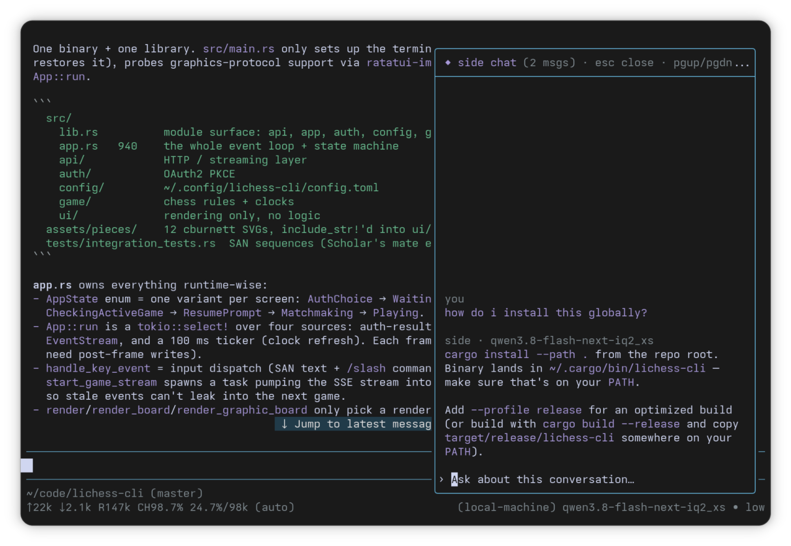

# pi-side-chat

Side chat for the [pi](https://pi.dev) coding agent. Ask quick questions about the current conversation in a panel on the side, without adding anything to the main conversation history.



## Install

```bash
pi install git:github.com/huytd/pi-side-chat
```

Or try it once without installing:

```bash
pi -e git:github.com/huytd/pi-side-chat
```

## Usage

| Action | Key / command |
|---|---|
| Open side chat | `alt+s` or `/side` |
| Open and ask right away | `/side <question>` |
| Close panel / cancel a streaming answer | `esc` |
| Scroll history | `pgup` / `pgdn` |
| Clear side-chat history for this session | `/side-clear` |

## How it works

- **Has the conversation's context.** Each side question gets a fresh snapshot of the main conversation, sent with the same system prompt and tool list as the main agent, so the provider can reuse its prompt cache.
- **Never changes the main conversation.** The extension only reads the session and calls the model directly. Nothing is added to the session file, and the main agent never sees side questions. Tool calls are blocked, so the side chat can't change files or run commands.
- **Keeps its own history.** Side chats are saved per session in `~/.pi/agent/side-chats/<sessionId>.jsonl` and show up again when you reopen the panel.

## Limitations

- The panel takes keyboard input while it's open, so close it to type in the main editor.
- The input box is a single line.
- A forked or new session starts with an empty side-chat history.
